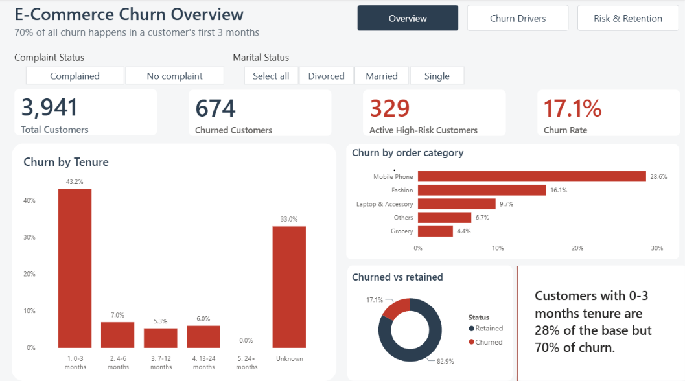
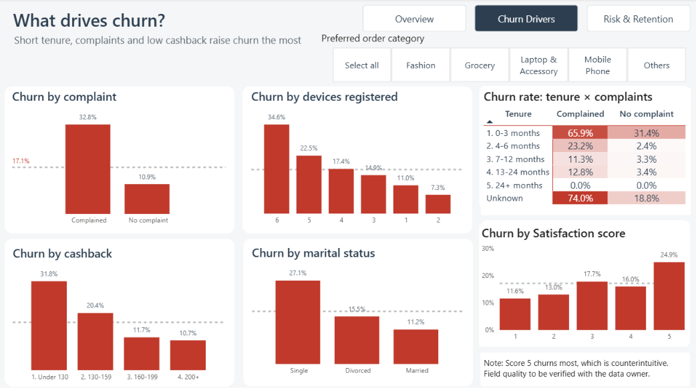
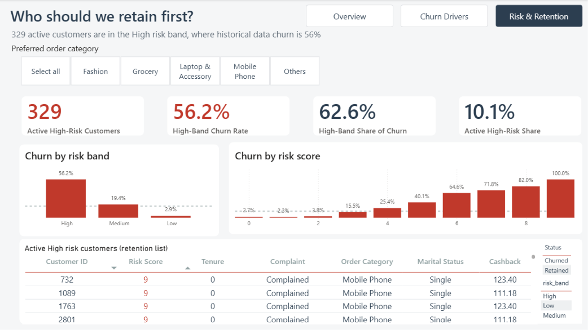

# E-commerce Customer Churn Analysis

**SQL · Power BI · Python**

An end-to-end churn project: SQL analysis to find who leaves and why, a 3-page Power BI dashboard, an automated Python pipeline, and a machine learning model that is compared against a transparent SQL risk score.



## Highlights
- **17.1% churn** (674 of 3,941 customers).
- **70% of all churn happens in a customer's first 3 months**, although those customers are only 28% of the base.
- New customers who **complained** churn at **66%**, against 31% for new customers who did not.
- A points-based SQL risk score isolates **329 active high-risk customers**, a group that historically churns at **56%**.
- A random forest model ranks churners better than the SQL score (ROC-AUC **0.95 vs 0.89**), but the simple SQL score comes close.

## Business problem
Losing customers means losing revenue, and winning a new customer costs more than keeping an existing one. This project finds **who churns, why, and what the business should do about it**.

**Data source:** public e-commerce customer churn dataset, 3,941 customers and 11 columns (tenure, complaints, satisfaction, order category, cashback, devices, addresses, warehouse distance, marital status, days since last order, churn flag). Source: [E-commerce Customer Churn dataset on Kaggle](https://www.kaggle.com/datasets/samuelsemaya/e-commerce-customer-churn).

## Repository structure
```
├── data/data_ecommerce_customer_churn.csv
├── sql/
│   ├── 01_setup_and_import.sql          create DB + table, load CSV (MySQL)
│   ├── 02_data_cleaning.sql             data-quality checks + clean view
│   ├── 03_churn_overview.sql            baseline churn rate, churned vs retained profile
│   ├── 04_factor_analysis.sql           churn rate by every factor + factor ranking
│   ├── 05_customer_segmentation.sql     high-risk segments and combinations
│   └── 06_risk_score_and_retention.sql  risk score, validation, retention target list
├── dashboard/
│   ├── ecommerce_churn_dashboard.pbix   Power BI report (data included)
│   └── churn_theme.json                 colour theme used in the report
├── pipeline/
│   ├── run_pipeline.py                  extract -> validate -> transform -> load -> views -> reconcile
│   └── model.py                         trains and compares churn models, scores active customers
├── tests/test_pipeline.py               automated checks (pytest)
├── outputs/                             model_comparison.csv, feature_importance.csv, churn_scores.csv
├── images/                              dashboard screenshots
├── requirements.txt
├── HOW_IT_WORKS.md                      plain-language guide to the pipeline and model
└── README.md
```

## Skills demonstrated
- **SQL:** `GROUP BY`, `CASE WHEN`, CTEs, subqueries, window functions (`RANK`), views, `UNION ALL`, `HAVING`, data cleaning, churn-rate calculations, segmentation, rules-based risk scoring.
- **Power BI:** data modelling, DAX measures, conditional formatting, slicers, page navigation, consistent design.
- **Python:** ETL pipeline with validation and reconciliation, pandas, scikit-learn, pytest.
- **Analytics:** turning findings into business recommendations, and flagging data-quality problems.

## Dashboard
Built in Power BI on top of the `customer_risk` SQL view. Dashboard totals match the SQL results (3,941 customers, 674 churned, 17.1% churn, 329 active high-risk customers).

| Overview | Churn drivers | Risk & retention |
|---|---|---|
|  |  |  |

**Key DAX measures:** Churn Rate, Share of All Churn, Active High-Risk Customers, High-Band Churn Rate, Active High-Risk Share.

### Open the dashboard
1. Install **Power BI Desktop** (free, Windows only) from the Microsoft Store.
2. Download `dashboard/ecommerce_churn_dashboard.pbix` (open the file on GitHub, then click **Download raw file**).
3. Open it in Power BI Desktop. The data is already inside the file, so no setup is needed.

> Please don't click **Refresh**: the data was imported from a local MySQL database, which refresh needs. The source CSV is in `data/`.

## How to run
**SQL analysis (MySQL 8):**
1. Run `sql/01_setup_and_import.sql`. If `LOAD DATA LOCAL INFILE` is blocked, use the Workbench **Table Data Import Wizard** on `customers_raw` instead.
2. Run scripts `02` to `06` in order. Each builds on the views created before it (`customers_clean`, then `customer_risk`). Scripts 02 to 06 also run unchanged in PostgreSQL and SQLite.

**Pipeline and model (Python 3.9+):**
```bash
pip install -r requirements.txt
python pipeline/run_pipeline.py     # rebuilds churn.db from the CSV: validation, load, SQL views, reconciliation
python pipeline/model.py            # trains models, writes outputs/*.csv
pytest -q                           # 7 automated tests
```

## Data cleaning decisions
| Issue | Finding | Decision |
|---|---|---|
| Missing values | Tenure 194, warehouse distance 169, days since last order 213 | Kept as NULL and grouped as "Unknown". Customers with missing tenure churn at 33% vs 16%, so dropping or filling them would hide a real signal |
| Inconsistent labels | "Mobile" (559) and "Mobile Phone" (887) | Merged into "Mobile Phone" |
| Duplicate rows | 671 exact duplicates | Flagged, not removed in SQL: the file has no customer ID, so identical rows may be different customers. Removed only when evaluating the model, to avoid train/test leakage |
| Customer ID | Not in the file | Added a surrogate `customer_id` |

## Key findings
**Overall churn rate: 17.1%** (674 of 3,941 customers).

| Factor | Highest-churn group | Lowest-churn group |
|---|---|---|
| Tenure | 0-3 months: **43.2%** | 24+ months: **0%** |
| Complaints | Complained: **32.8%** | No complaint: 10.9% |
| Order category | Mobile Phone: **28.6%** | Grocery: 4.4% |
| Marital status | Single: **27.1%** | Married: 11.2% |
| Cashback | Under 130: **31.8%** | 200+: 10.7% |
| Devices registered | 6 devices: **34.6%** | 2 devices: 7.3% |

1. **The first three months decide everything.** Customers with 0-3 months tenure are 28% of the base but 70% of all churn (470 of 674). After month 3, churn drops to about 5-7%.
2. **Complaints multiply the risk.** New customers who complained churn at **66%**, against 31% for new customers who did not. Established customers (4+ months) with no complaint churn at just **2-3%**.
3. **Mobile Phone buyers are the weak spot.** They are 37% of customers but 61% of churners. Single mobile phone buyers churn at **41%**.
4. **Low cashback goes with high churn.** Customers getting under 130 churn at 31.8%, three times the rate of those getting 200+. This shows association, not proof that raising cashback would cause retention.
5. **Two results go against intuition:**
   - **Satisfaction score:** the happiest customers (score 5) churn the most (24.9%), and score-1 customers churn least (11.6%). This may be a data-collection quirk or a reversed scale, and it should be checked with the data owner before anyone trusts the field.
   - **Days since last order:** customers who ordered very recently churn *more* (21.8% at 0-3 days vs 9.9% at 8-14 days). This is probably because new customers are the ones with recent orders, so it is a confounded variable.

   Because of this, the risk score leaves both fields out.

## Risk score (script 06)
A points-based score using tenure, complaints, marital status, order category, cashback and devices:

| Risk band | Customers | Churn rate | Share of all churn |
|---|---|---|---|
| High (5+ points) | 751 | **56.2%** | 62.6% |
| Medium (3-4) | 968 | 19.4% | 27.9% |
| Low (0-2) | 2,222 | 2.9% | 9.5% |

**329 active customers** (10% of the retained base) sit in the High band. They are the first group to contact in a retention campaign.

## Pipeline and machine learning
**Pipeline:** validates the raw file (columns, ranges, blanks), cleans it, loads it into SQLite, runs the SQL views from `sql/`, and reconciles the totals (3,941 customers, 674 churned, 329 active high-risk). Re-running does not duplicate data.

**Model results (held-out 20% test set, duplicates removed):**

| Model | ROC-AUC | Precision | Recall |
|---|---|---|---|
| Random forest | 0.952 | 0.70 | 0.81 |
| Gradient boosting | 0.948 | 0.73 | 0.66 |
| Logistic regression | 0.924 | 0.43 | 0.92 |
| SQL risk score (rules) | 0.890 | n/a | n/a |

Tenure is by far the most important input, followed by complaints, which agrees with the SQL findings. The simple SQL score comes close to the model, so it remains a good option for a business team that wants transparency. `outputs/churn_scores.csv` lists every active customer with a churn probability and can be loaded into Power BI. See [HOW_IT_WORKS.md](HOW_IT_WORKS.md) for a plain-language explanation.

## Recommendations
| Finding | Action |
|---|---|
| Most churn happens in months 0-3 | Build a 90-day onboarding programme: welcome offers, check-ins at day 30 and day 60, a second-order incentive |
| New customers with complaints churn at 66% | Route complaints from customers under 3 months old to a priority queue with a guaranteed resolution time and a follow-up call |
| Mobile Phone buyers churn at 29% | Review the mobile category: delivery quality, returns, pricing, accessories cross-sell. Interview churned mobile buyers |
| Low cashback, high churn | A/B test a higher cashback tier for the 530 customers under 130 before rolling it out widely |
| 329 active high-risk customers | Run a targeted retention campaign and size the expected gain with the 20% scenario in script 06 |
| Satisfaction and recency fields behave oddly | Audit how they are collected before using them in any model or KPI |

## Limitations
- The dataset has no payment method, coupon count or order-frequency columns, so cashback is used as the incentive measure.
- No dates, so churn timing and cohort trends cannot be analysed, and the model is not validated over time.
- Only about 3,300 unique customers, so model metrics are indicative, not production performance.
- The SQL risk score was built and checked on the same data, so it looks cleaner than it would on new customers.
- The data shows correlation only. Test the actions above before large investment.

## Next steps
- Schedule the pipeline (cron or Airflow) and run the tests automatically with GitHub Actions.
- Add the model's churn probabilities to the dashboard as a second retention list.
- Validate the score and model on a later time period if dated data becomes available.

## Author
**Harshit Jha** · [LinkedIn](https://www.linkedin.com/in/harshitjha03) · [GitHub](https://github.com/harshit-jha404)
